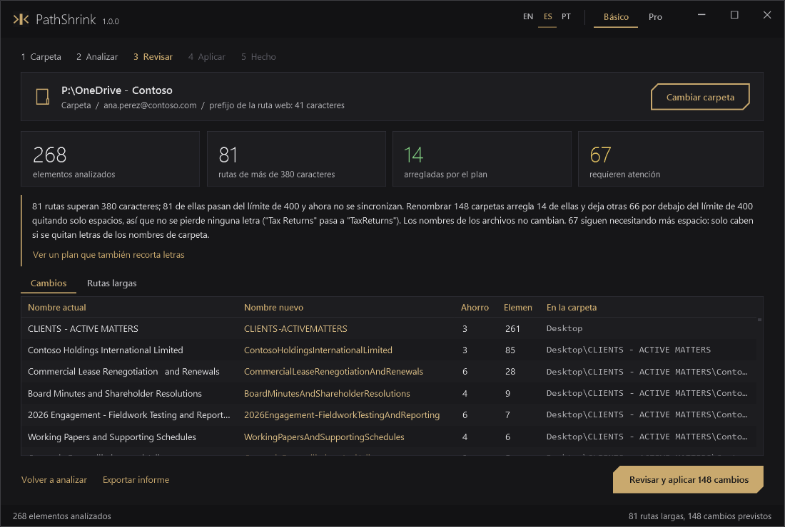
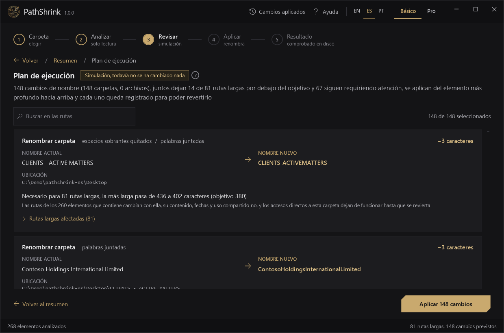
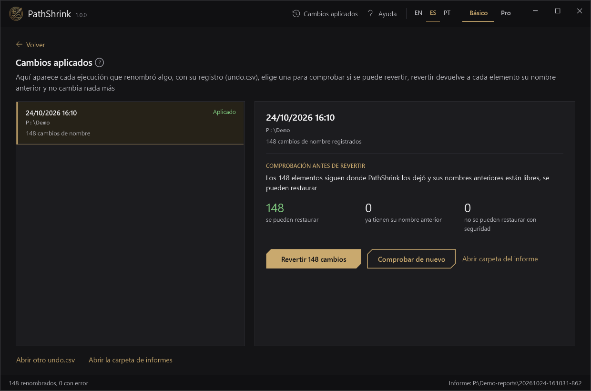

<div align="center">

# PathShrink

Rutas de OneDrive y SharePoint de más de 400 caracteres, resueltas con el mínimo de renombrados. Primero sin perder letras.

[](https://github.com/4leX-42/PathShrink/actions/workflows/ci.yml)    [](LICENSE)



<sub>[English](README.md) · Parte de <a href="https://github.com/4leX-42/GADGETS-SUPPORT_CX">GADGETS-SUPPORT_CX</a></sub>

</div>

##  Instalar

PowerShell normal, con la cuenta dueña del OneDrive (sin elevar):

```powershell
Set-ExecutionPolicy -Scope Process Bypass -Force; [Net.ServicePointManager]::SecurityProtocol=3072; $f="$env:TEMP\install-pathshrink.ps1"; irm https://raw.githubusercontent.com/4leX-42/PathShrink/main/install.ps1 -OutFile $f; powershell -NoProfile -ExecutionPolicy Bypass -File $f
```

Por usuario, sin admin, con SHA-256 comprobado. `-NoExe` si un antivirus o EDR detiene `PathShrink.exe`; `-Uninstall` lo quita. Zips portables en [Releases](https://github.com/4leX-42/PathShrink/releases/latest).

##  Qué hace

| | |
|---|---|
|  **Longitud en servidor** | Cuenta la ruta web decodificada, con el prefijo de la biblioteca, como Microsoft |
|  **Primero sin pérdida** | Espacios antes que letras; letras solo con recorte activado |
|  **Plan mínimo** | Carpetas antes que archivos; solo los renombrados que arreglan una ruta |
|  **Vista previa y verificación** | Nada cambia sin confirmar; el resultado se relee en disco |
|  **Reversión comprobada** | `undo.csv` por ejecución; solo restaura lo que sigue donde quedó |
|  **Otros bloqueos** | Nombres reservados, `~$`, `_vti_`, nombres de más de 255 (Pro) |

No borra, no mueve, no descarga; no toca el registro ni el sistema; sin red. Solo escribe en `%LOCALAPPDATA%\PathShrink`.

| Plan de ejecución | Cambios aplicados y reversión |
|---|---|
|  |  |

##  Línea de comandos

```powershell
Import-Module .\PathShrink\PathShrink.psd1
Invoke-PathShrink -WhatIf                     # solo el plan
Invoke-PathShrink -AllowTrim -MinNameLength 25
Get-PathShrinkHistory                         # ejecuciones que renombraron algo
Undo-PathShrink -UndoFile "$env:LOCALAPPDATA\PathShrink\Reports\<ejecucion>\undo.csv"
```

<sub>Algoritmo, ajustes Pro, limitaciones y solución de problemas: [README en inglés](README.md).</sub>

<div align="center">

<sub>[MIT](LICENSE) · Sin relación con Microsoft</sub>

</div>
