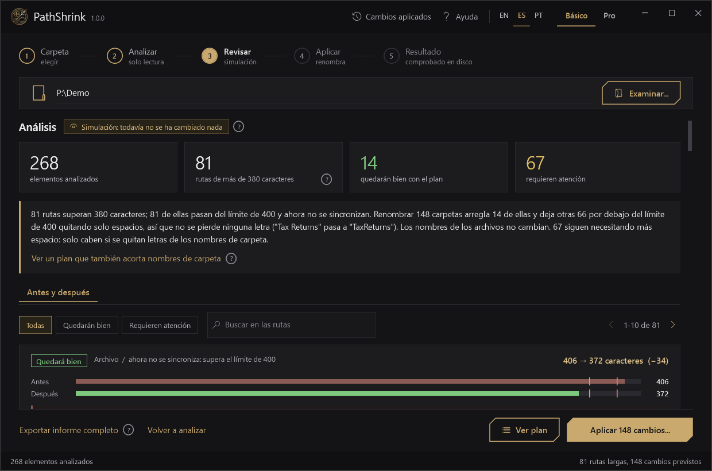

# PathShrink

**Encuentra y arregla las rutas de OneDrive y SharePoint que pasan del límite de 400 caracteres, sin perder ninguna letra.**

[English](README.md)



OneDrive y SharePoint rechazan cualquier archivo cuya **ruta web decodificada** supere 400 caracteres.
Esa ruta no es la que ves en el Explorador: delante de cada carpeta y del nombre del archivo va la
dirección de la biblioteca, por ejemplo `personal/ana_perez_contoso_com/Documents/` (41 caracteres).
Las carpetas de clientes y proyectos con muchos niveles llegan al límite, el cliente de sincronización
avisa de *"ruta demasiado larga"* y alguien tiene que ir renombrando a mano hasta que quepa.

PathShrink mide cada ruta como la mide el servicio, calcula el **mínimo de renombrados de carpeta**
que la deja por debajo del límite, te enseña el plan y solo renombra cuando confirmas. Quita espacios
antes que letras, no toca nombres de archivo salvo que lo permitas, comprueba el resultado en disco y
guarda un fichero para deshacer.

## Qué hace

- **Mide la longitud en el servidor**, no la local: lee la URL de cada biblioteca del cliente de
  OneDrive (OneDrive personal y bibliotecas de SharePoint sincronizadas).
- **Primero sin pérdida**: quita espacios dobles y espacios alrededor de `-` `_` `,`; después junta
  palabras (`Tax Returns` pasa a `TaxReturns`). Para en cuanto la ruta cabe.
- **Letras solo si lo pides**: el recorte opcional quita letras del final de los nombres de carpeta más
  largos, repartido entre niveles, nunca por debajo de una longitud mínima.
- **Carpetas antes que archivos**; cambios mínimos; vista previa, confirmación, verificación y `undo.csv`.
- **Ámbito seguro**: nunca renombra por encima de la carpeta elegida ni el primer nivel del OneDrive
  personal (Escritorio, Documentos, Imágenes); salta accesos directos a otras bibliotecas, uniones y enlaces simbólicos.
- **No descarga** los archivos que solo están en la nube.
- **Otros bloqueos de sincronización** (modo Pro): nombres reservados, `_vti_`, `~$`, espacios al inicio o final.
- **Reversión comprobada**: cada cambio de nombre se anota en `undo.csv` en el momento. Al revertir se
  comprueba antes cada elemento y solo se restaura si sigue donde PathShrink lo dejó y su nombre antiguo
  está libre; lo que se haya movido, renombrado otra vez, sustituido o borrado se salta y se indica, sin
  sobrescribir nada.
- Ventana con modo **Básico** y **Pro** en inglés, castellano y portugués (selector EN / ES / PT; por
  defecto, el idioma de Windows): comparación antes y después, plan de ejecución completo, historial de
  cambios aplicados con reversión, ayuda contextual, demostración interactiva con datos inventados y el
  selector de carpetas de Windows. Informes HTML, CSV y JSON, y línea de comandos.
- Windows PowerShell 5.1 y PowerShell 7. Sin administrador, sin módulos, sin internet.

## Empezar

```powershell
$f = "$env:TEMP\install-pathshrink.ps1"
irm https://raw.githubusercontent.com/4leX-42/PathShrink/main/install.ps1 -OutFile $f
powershell -NoProfile -ExecutionPolicy Bypass -File $f
```

Instala para el usuario actual en `%LOCALAPPDATA%\Programs\PathShrink` con acceso en el menú Inicio,
comprobando el SHA-256 del zip. Se quita con `install.ps1 -Uninstall`. También vale el zip portable de
[Releases](https://github.com/4leX-42/PathShrink/releases/latest): descomprimir y abrir `PathShrink.cmd`.

Ejecútalo **con la cuenta del usuario dueño del OneDrive**, sin elevar con otra cuenta.

## Línea de comandos

```powershell
Import-Module .\PathShrink\PathShrink.psd1
Invoke-PathShrink -WhatIf                     # solo el plan
Invoke-PathShrink -AllowTrim -MinNameLength 25
Get-PathShrinkHistory                         # ejecuciones que renombraron algo
Test-PathShrinkUndo -UndoFile "$env:LOCALAPPDATA\PathShrink\Reports\<ejecucion>\undo.csv"   # qué se puede revertir
Undo-PathShrink -UndoFile "$env:LOCALAPPDATA\PathShrink\Reports\<ejecucion>\undo.csv"       # revierte lo seguro
```

## Qué cambia y qué no

Renombra carpetas (y archivos solo con recorte) dentro de la carpeta elegida. Nunca cambia contenido,
fechas, permisos ni uso compartido; no borra, no mueve, no descarga, no toca el registro ni la
configuración del sistema. Lee `HKCU\Software\Microsoft\OneDrive\Accounts` y
`HKCU\Software\SyncEngines\Providers\OneDrive`, y solo escribe en `%LOCALAPPDATA%\PathShrink`.
Como cualquier renombrado, los accesos directos, anclajes y enlaces copiados que apunten dentro de una
carpeta renombrada dejan de funcionar hasta que se revierte. Revertir devuelve nombres a partir del
registro de esa ejecución; no puede restaurar lo que se renombró otra vez, se movió o se borró después,
ni lo que tenga ocupado su nombre antiguo: eso se salta y se indica.

Limitaciones, solución de problemas y detalle del algoritmo: en el [README en inglés](README.md).

## Licencia

[MIT](LICENSE). Sin relación con Microsoft. OneDrive y SharePoint son marcas de Microsoft.
