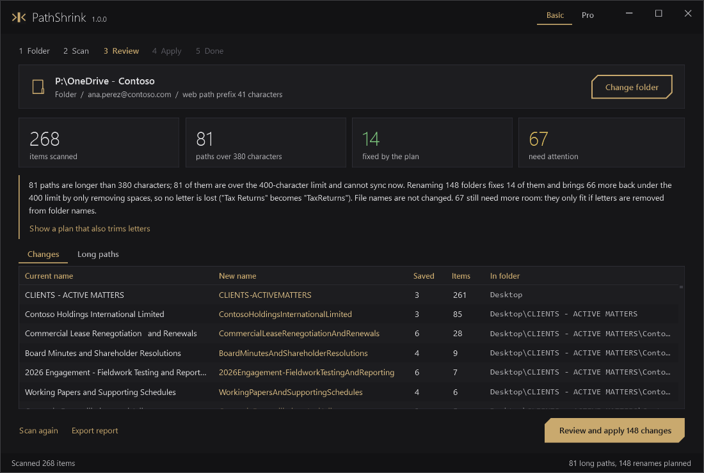
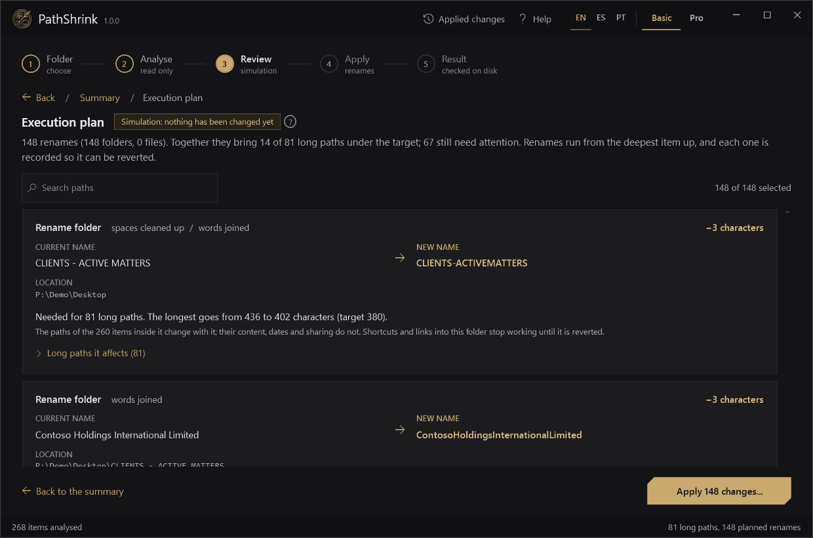
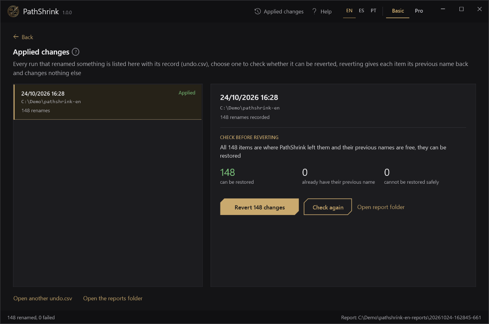

<div align="center">

# PathShrink

OneDrive and SharePoint paths over 400 characters, fixed with the fewest renames. Lossless first.

[](https://github.com/4leX-42/PathShrink/actions/workflows/ci.yml)    [](LICENSE)



<sub>[Español](README.es.md) · Part of <a href="https://github.com/4leX-42/GADGETS-SUPPORT_CX">GADGETS-SUPPORT_CX</a></sub>

</div>

##  Install

Normal PowerShell, as the user who owns the OneDrive (not elevated):

```powershell
Set-ExecutionPolicy -Scope Process Bypass -Force; [Net.ServicePointManager]::SecurityProtocol=3072; $f="$env:TEMP\install-pathshrink.ps1"; irm https://raw.githubusercontent.com/4leX-42/PathShrink/main/install.ps1 -OutFile $f; powershell -NoProfile -ExecutionPolicy Bypass -File $f
```

Per user, no admin, SHA-256 checked. Add `-NoExe` if an antivirus or EDR stops `PathShrink.exe`; `-Uninstall` removes it. Portable zips in [Releases](https://github.com/4leX-42/PathShrink/releases/latest).

##  What it does

| | |
|---|---|
|  **Server-side length** | Counts the decoded web path, library prefix included, as Microsoft does |
|  **Lossless first** | Spaces before letters; letters only if you allow trimming |
|  **Minimal plan** | Folders before files; a rename is kept only if it fixes a path |
|  **Preview, confirm, verify** | Nothing changes until you confirm; the result is re-read from disk |
|  **Checked revert** | `undo.csv` per run; restores only what is still where it was left |
|  **Other blockers** | Reserved names, `~$` lock files, `_vti_`, names over 255 (Pro) |

Never deletes, moves or downloads; no registry or system changes; no network. Writes only to `%LOCALAPPDATA%\PathShrink`.

| Execution plan | Applied changes and revert |
|---|---|
|  |  |

##  Command line

```powershell
Import-Module .\PathShrink\PathShrink.psd1
Invoke-PathShrink -WhatIf                                   # plan only
Invoke-PathShrink -Path "$env:OneDriveCommercial\Clients"   # plan, confirm, rename, verify
Invoke-PathShrink -AllowTrim -MinNameLength 25 -Confirm:$false
Undo-PathShrink -UndoFile "$env:LOCALAPPDATA\PathShrink\Reports\<run>\undo.csv"
```

<details>
<summary> <b>How the plan works</b></summary>

For every path longer than *limit minus margin* (380 by default), shallowest first:

1. **Clean-up**: double spaces, spaces around `-` `_` `,`, trailing spaces and dots.
2. **Remove spaces**, capitalising each word. Names in CAPITALS go last.
3. **Trim** (only with *Allow trimming*): one letter at a time from the longest folder name.
4. **File name** (only with trimming, when no folder can give more), extension kept.

Stops as soon as the path fits. Collisions get a `~2` suffix.

```text
Before (414): Desktop\CLIENTS - ACTIVE MATTERS\Fabrikam Industrial Components Group\Employment and Labour Disputes - Regional Office\...
After  (380): Desktop\CLIENTS-ACTIVEMATTERS\FabrikamIndustrialComponentsGroup\EmploymentAndLabourDisputes-RegionalOffice\...
```
</details>

<details>
<summary> <b>Pro settings</b></summary>

| Setting | What it does | Default |
|---|---|---|
| Limit | Server limit in characters | 400 |
| Safety margin | Also fix paths this close to the limit | 20 |
| Shorten names | Remove letters from the end of the longest folder names | off |
| Shortest name | Never shorten a name below this length | 20 |
| Exclude | Wildcards for folders not to scan or rename | none |
| Never rename | Wildcards for names counted but never renamed | none |
| Server prefix | Library path when it cannot be detected | detected |

Plus a check box per rename, *Other sync issues*, *Log*, *Check this computer*, *Copy as command* and *Open another undo.csv*.
</details>

<details>
<summary> <b>Requirements and limitations</b></summary>

- Windows 10 or 11, Windows PowerShell 5.1 or PowerShell 7. The window needs WPF and *FullLanguage* mode.
- OneDrive for work or school, or a synced SharePoint library; any other folder with `-Root` and `-Prefix`.
- The exe is not signed: some EDRs stop it (use `-NoExe`). Its source is `tools/Launcher.cs`.
- Constrained Language Mode blocks the window; AllSigned policy blocks unsigned scripts.
- Renames break shortcuts, Quick access pins and copied links into renamed folders until reverted.
- If OneDrive asks *"Delete these items?"* after renaming: choose **Keep**.
</details>

<details>
<summary> <b>Troubleshooting</b></summary>

| Symptom | Cause and fix |
|---|---|
| *No OneDrive for work or school account* | Not signed in, or running as another user. Sign in, or pick a folder. |
| *This folder is not inside OneDrive* | Not under a synced library. Set the server prefix (Pro) or `-Root` / `-Prefix`. |
| Some items *could not be renamed* | A file is open or access is denied. PathShrink names the program and offers to retry. |
| The window does not open | Run `.\PathShrink.ps1` from PowerShell to see the error (usually CLM or AllSigned). |
| *path too long* still shown | Wait for OneDrive to sync, then scan again. |
| Zip files blocked | `Get-ChildItem -Recurse \| Unblock-File`, or use `install.ps1`. |

`Get-PathShrinkEnvironment` prints what matters for a bug report. [CONTRIBUTING.md](CONTRIBUTING.md) · [SECURITY.md](SECURITY.md)
</details>

<div align="center">

<sub>[MIT](LICENSE) · Not affiliated with Microsoft</sub>

</div>
