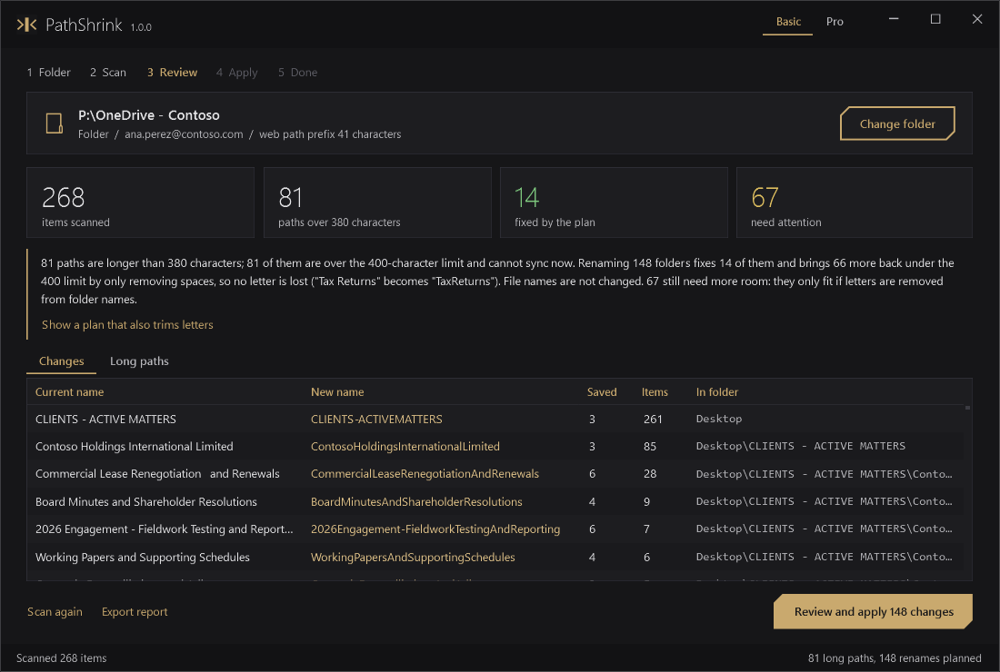
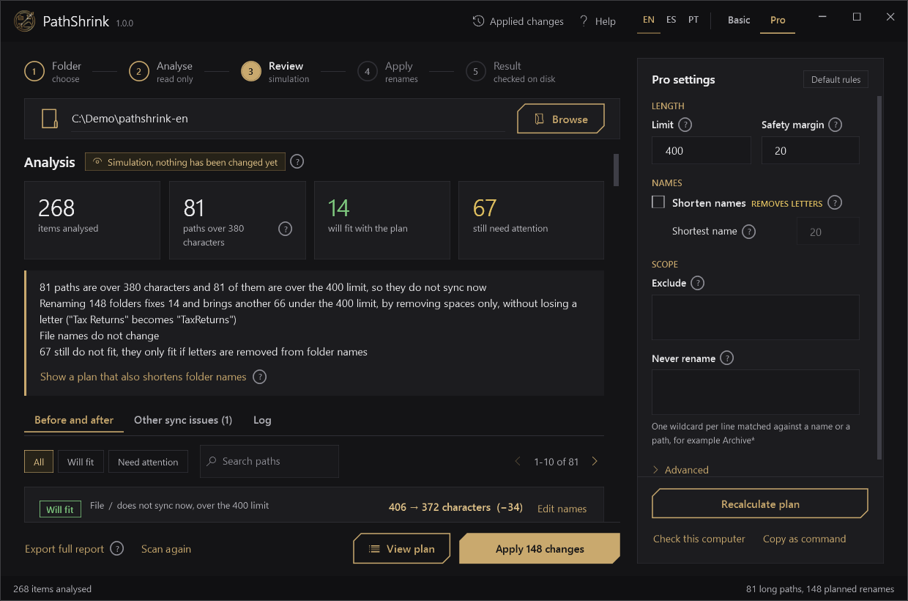
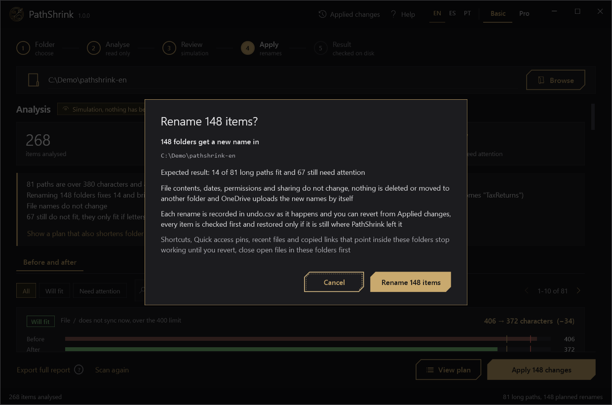

# PathShrink

**Find and fix OneDrive and SharePoint paths over the 400-character limit, without losing a letter.**

[](https://github.com/4leX-42/PathShrink/actions/workflows/ci.yml)


[](LICENSE)

[Español](README.es.md)



OneDrive and SharePoint refuse any file whose **decoded web path** is longer than 400 characters.
That path is not what you see in Explorer: it includes the library address, for example
`personal/ana_perez_contoso_com/Documents/` (41 characters) in front of every folder and the file
name. Deep client and project folders hit the limit, the sync client shows *"path too long"*, and
someone has to rename folders by hand until it fits.

PathShrink measures each path the way the service does, works out the **smallest set of folder
renames** that brings it back under the limit, shows you the plan, and only renames after you
confirm. It removes spaces before it removes letters, never touches file names unless you allow it,
checks the result on disk and keeps an undo file.

## Features

- **Server-side length, not local length.** Reads the library URL from the OneDrive client
  (personal OneDrive, synced SharePoint libraries and their prefixes) and counts what Microsoft counts.
- **Lossless first.** Step 1 removes double spaces and spaces around `-` `_` `,`. Step 2 joins words
  (`Tax Returns` becomes `TaxReturns`). It stops as soon as a path fits.
- **Letters only if you say so.** Optional trimming cuts letters from the end of the longest folder
  names, spread across levels, never below a minimum length you choose.
- **Folders before files.** File names are not renamed unless trimming is on and no folder can give more.
- **Minimal changes.** A rename is kept only if it fixes a path or brings it back under the hard limit.
- **Preview, confirm, verify, undo.** Nothing changes until you confirm. After renaming it re-reads
  the disk, and every successful rename is written to `undo.csv` as it happens.
- **Safe scope.** Never renames above the folder you pick, nor the first level of a personal OneDrive
  (Desktop, Documents, Pictures). Shortcuts to other libraries, junctions and symbolic links are skipped.
- **No downloads.** Cloud-only (Files On-Demand) files are listed, not downloaded.
- **Other sync blockers** (Pro): reserved names (`CON`, `.lock`...), `_vti_`, `~$` lock files,
  leading or trailing spaces, names over 255 characters.
- **Reports** in CSV, JSON and HTML.
- **GUI with Basic and Pro modes** in English, Spanish and Portuguese (EN / ES / PT switch, follows the Windows language by default), and the same engine from the command line.
- Windows PowerShell 5.1 and PowerShell 7. No admin rights, no modules to install, no internet access needed.

## Quick start

**Option 1: install for the current user** (Start menu shortcut, no admin):

```powershell
$f = "$env:TEMP\install-pathshrink.ps1"
irm https://raw.githubusercontent.com/4leX-42/PathShrink/main/install.ps1 -OutFile $f
powershell -NoProfile -ExecutionPolicy Bypass -File $f
```

The installer downloads the release zip, checks its SHA-256, unpacks it to
`%LOCALAPPDATA%\Programs\PathShrink` and adds a Start menu shortcut. Read it before running it: it is
short. Remove with `install.ps1 -Uninstall`.

**Option 2: portable.** Download `PathShrink.zip` from
[Releases](https://github.com/4leX-42/PathShrink/releases/latest), unzip, double-click `PathShrink.cmd`.

**Option 3: PowerShell Gallery** *(planned)*:

```powershell
Install-Module PathShrink -Scope CurrentUser
Start-PathShrink
```

Run it **as the user who owns the OneDrive**, not elevated as another account: the OneDrive folders
and accounts are read from the current user's profile.

## Using the window

| Basic | Pro |
|---|---|
|  |  |

**Basic** (default) is a guided flow: the OneDrive folder is detected for you; *Scan* lists what
is too long and why; *Review and apply* shows a summary of what will happen and asks for
confirmation; the last page shows the verified result and an *Undo* button. If some paths only fit
by removing letters, Basic offers that plan as a separate, clearly marked step.

**Pro** adds:

| Setting | What it does | Default |
|---|---|---|
| Limit | Server limit in characters | 400 |
| Safety margin | Also fix paths this close to the limit, so the next longer file name does not fail again | 20 |
| Allow trimming letters | Cut letters from the end of the longest folder names (marked *changes words*) | off |
| Shortest name | Never trim a name below this length | 20 |
| Exclude | Wildcards for folders not to scan or rename | none |
| Protect names | Wildcards for names that are counted but never renamed | none |
| Server prefix | Library path to use when it cannot be detected (copied folders, other machines) | detected |

Plus a check box per rename (the totals update live), the *How* column (which step produced each
name), *Other sync issues*, the *Log*, *Undo from a file*, *Check this computer*, and
*Copy as command line* to repeat the same run in a script.



## Command line

```powershell
Import-Module .\PathShrink\PathShrink.psd1

Invoke-PathShrink -WhatIf                                   # plan only, current user's OneDrive
Invoke-PathShrink -Path "$env:OneDriveCommercial\Clients"   # plan, confirm, rename, verify
Invoke-PathShrink -AllowTrim -MinNameLength 25 -Confirm:$false
Invoke-PathShrink -Root D:\Export\Legal -Prefix 'sites/Legal/Shared Documents/' -WhatIf
Undo-PathShrink -UndoFile "$env:LOCALAPPDATA\PathShrink\Reports\<run>\undo.csv"
```

`.\PathShrink.ps1` with any of these parameters runs the command line; without parameters it opens
the window. The building blocks are exported too: `Get-PathShrinkLibrary`,
`Get-PathShrinkInventory`, `New-PathShrinkPlan`, `Invoke-PathShrinkPlan`, `Find-PathShrinkSyncIssue`,
`Export-PathShrinkReport`. `Get-Help <command> -Full` documents each one.

## How the plan works

For every path longer than *limit minus margin* (380 by default), shallowest first:

1. **Clean-up** of folder names: double spaces, spaces around `-` `_` `,`, trailing spaces and dots.
2. **Remove spaces** from folder names, capitalising each word. Names in CAPITALS go last because
   they are hard to read without spaces.
3. **Trim** (only with *Allow trimming*): one letter at a time from the end of the longest folder name.
4. **File name** (only with *Allow trimming* and when no folder can give more), keeping the extension.

It stops as soon as the path fits. A shared parent folder renamed for one path also shortens every
path below it, which is why the shallowest paths are planned first. Name collisions get a `~2`
suffix.

Real output on the demo folder (`tools\New-DemoFolder.ps1`), personal OneDrive of
`ana.perez@contoso.com`, prefix `personal/ana_perez_contoso_com/Documents/` (41 characters):

```text
Before (414): Desktop\CLIENTS - ACTIVE MATTERS\Fabrikam Industrial Components Group\Employment and Labour Disputes - Regional Office\Financial Statements and Tax Returns\2026 Engagement - Fieldwork Testing and Reporting\Working Papers and Supporting Schedules\Quarterly Reconciliations and Adjustments\Reviewed by Partner - Final Versions\Appendix A - detailed general ledger export.xlsx
After  (380): Desktop\CLIENTS-ACTIVEMATTERS\FabrikamIndustrialComponentsGroup\EmploymentAndLabourDisputes-RegionalOffice\FinancialStatementsAndTaxReturns\2026Engagement-FieldworkTestingAndReporting\WorkingPapersAndSupportingSchedules\QuarterlyReconciliationsAndAdjustments\ReviewedByPartner-FinalVersions\Appendix A - detailed general ledger export.xlsx
```

Every letter is still there, and the file name is untouched.

## What it changes, and what it never does

- It **renames folders** (and, only with trimming, files) inside the folder you choose. Nothing else.
- It **never** changes file contents, dates, permissions or sharing; never deletes, moves or
  downloads anything; never edits the registry or any system setting; never needs admin rights.
- It reads `HKCU\Software\Microsoft\OneDrive\Accounts` and `HKCU\Software\SyncEngines\Providers\OneDrive`
  to find the libraries.
- It writes only to `%LOCALAPPDATA%\PathShrink` (reports, undo files, logs).
- It makes no network connection. `install.ps1` downloads the release from GitHub; PathShrink itself does not.

Side effects of any rename, which the confirmation repeats: desktop shortcuts, Quick access pins,
recent-file lists and copied links that point inside a renamed folder stop working. Files open in
another program cannot be renamed: they are reported, the rest continues.

## Requirements

- Windows 10 or 11.
- Windows PowerShell 5.1 (built in) or PowerShell 7 (tested on 7.6).
- The window needs .NET WPF (included in Windows) and *FullLanguage* mode.
- OneDrive for work or school, or a synced SharePoint library. Any other folder works with `-Root` and `-Prefix`.

## Known limitations

- **Constrained Language Mode** (AppLocker or WDAC in some companies) blocks the window. The
  command line works where the module can load; signed builds are not provided yet.
- **AllSigned execution policy** set by Group Policy blocks unsigned scripts, including this one.
- The personal OneDrive prefix is computed from the e-mail only when the OneDrive client has not
  recorded the library URL; if the account was renamed, pass `-Prefix` with the real URL path.
- The 400 limit is Microsoft's documented service limit. If Microsoft changes it, set *Limit*.
- Characters are counted as .NET UTF-16 units: an emoji counts as 2, which errs on the safe side.
- The OneDrive personal (consumer) client is not detected; use `-Root` and `-Prefix`.

## Troubleshooting

| Symptom | Cause and fix |
|---|---|
| *No OneDrive for work or school account* | Not signed in to OneDrive in this Windows profile, or running as another user. Sign in, or pick a folder. |
| *This folder is not inside OneDrive* | The folder is not under a synced library. In Pro mode type the server prefix, or use `-Root` / `-Prefix`. |
| Some items *could not be renamed* | A file is open (Word, Excel, Outlook attachment preview) or access is denied. Close it and scan again. |
| The window does not open, nothing happens | Run `.\PathShrink.ps1` from a PowerShell window to see the error. Constrained Language Mode or AllSigned policy are the usual causes. |
| *path too long* still shown in OneDrive | Give the client a few minutes to sync the renames; then scan again. |
| Files downloaded from the zip are blocked | `Get-ChildItem -Recurse \| Unblock-File` in the folder, or use `install.ps1`. |

*Check this computer* (Pro) or `Get-PathShrinkEnvironment` prints the facts that matter for a bug report.

## Contributing

Bug reports with the output of `Get-PathShrinkEnvironment` are the most useful contribution.
See [CONTRIBUTING.md](CONTRIBUTING.md) for tests and code rules, and [SECURITY.md](SECURITY.md)
to report a vulnerability privately.

## License

[MIT](LICENSE). Not affiliated with Microsoft. OneDrive and SharePoint are trademarks of Microsoft.
